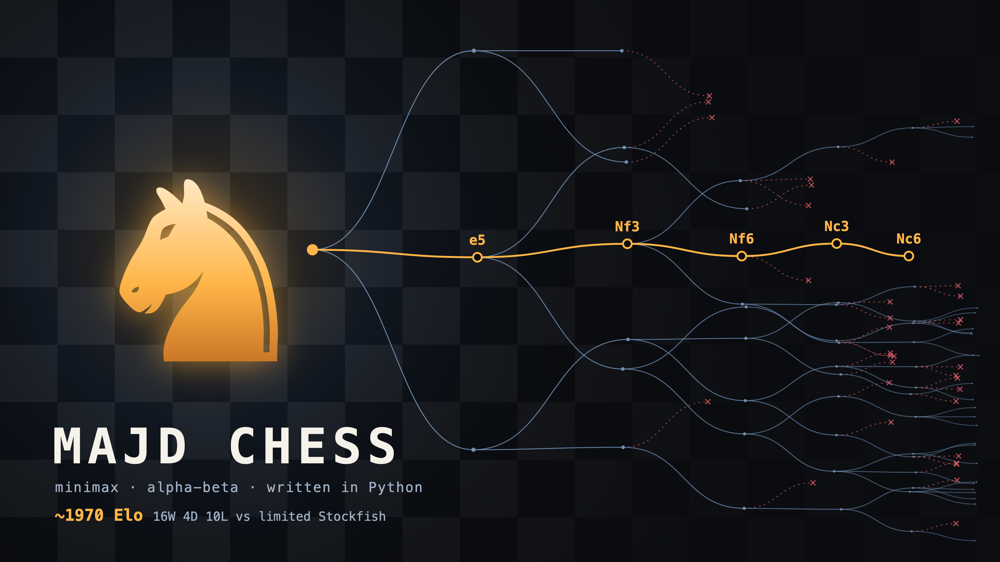

# Majd Chess

A chess engine written in Python, with a desktop app to play against it.



## Features

- Alpha-beta search with iterative deepening, a transposition table and quiescence search
- Null-move pruning, late move reductions and principal variation search
- Tapered evaluation using the published PeSTO piece-square tables
- 10 difficulty levels
- Desktop app that explains what the engine is thinking
- UCI support, so it works with chess GUIs such as En Croissant, Cute Chess and Arena

## Strength

Roughly 1970 Elo on Stockfish's limited-strength scale, at 0.5 seconds per move on the top level. This is a rough estimate from 30 games, not an official or human rating:

| Stockfish setting | Wins | Draws | Losses |
| --- | --- | --- | --- |
| 1600 | 7 | 1 | 2 |
| 1900 | 6 | 1 | 3 |
| 2200 | 3 | 2 | 5 |

## Getting started

Requires Python 3.12 or newer.

```bash
git clone https://github.com/MajdHail/chess-engine.git
cd chess-engine
python3 -m venv .venv
source .venv/bin/activate
pip install -r requirements.txt
python app.py
```

## Usage

**Run the tests:**

```bash
python test_engine.py
```

**Play a match against Stockfish** ([install it](https://stockfishchess.org/download/) first):

```bash
python match.py --games 10 --time 1 --elo 1800
```

Add `--stockfish /path/to/stockfish` if it isn't on your PATH. Games are saved to `match.pgn`.

**Use it in a chess GUI:** add `python uci.py` as a UCI engine. If the GUI needs a single executable, point it at a small script that runs `uci.py` with the Python from `.venv`.

## How it works

The engine scores a position by material and piece placement, then searches ahead for the line that works out best if both sides play well. Most of the code exists to skip positions that can't change the answer.

| File | Purpose |
| --- | --- |
| `evaluation.py` | Scores a position |
| `engine.py` | Searches for the best move |
| `uci.py` | Speaks the UCI protocol to other chess programs |
| `app.py`, `index.html` | The desktop app |
| `match.py` | Plays matches against Stockfish |
| `test_engine.py` | Tests and chess puzzles |

## Credits

- [python-chess](https://python-chess.readthedocs.io) handles the rules of chess
- Evaluation values come from [PeSTO](https://www.chessprogramming.org/PeSTO%27s_Evaluation_Function) by Ronald Friederich

## License

[GPL-3.0](LICENSE)
